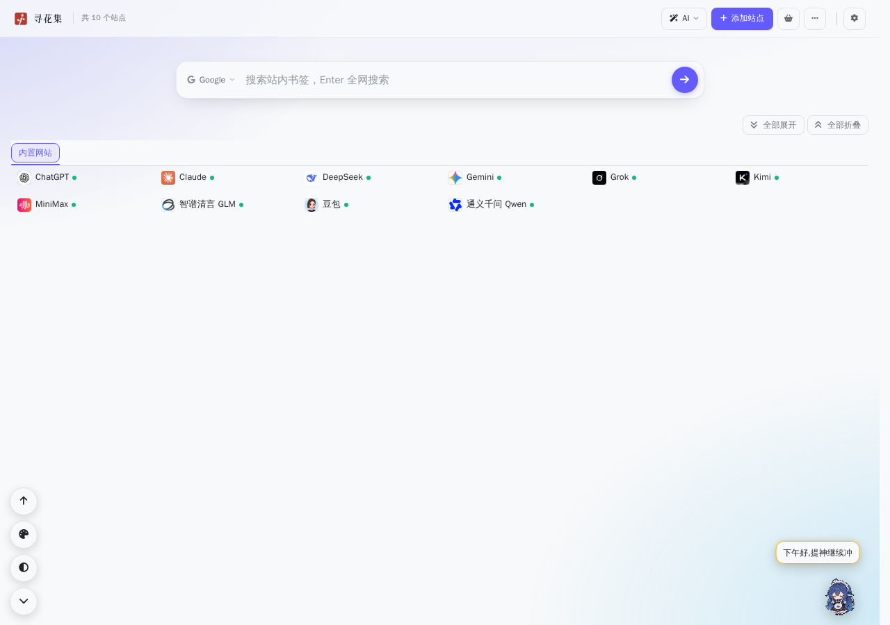

<div align="center">

# Flori-Nav

**寻花集 · 一个可自托管的个人书签导航站**

主人维护，访客只读；桌面与手机共用一套页面。

[](https://www.python.org/)
[](https://www.djangoproject.com/)
[](https://www.postgresql.org/)
[](https://vercel.com/)
[](LICENSE)

[界面](#界面) · [特性](#核心特性) · [快速开始](#快速开始) · [主人模式](#2-主人模式--访客模式) · [配置](#常用环境变量) · [部署](#部署) · [开发](#开发)

</div>

## 界面

<p align="center">
  
  
</p>

截图使用「门户密度」预设。默认内置 10 个常用 AI 入口，平铺在「内置网站」分类下；导入自己的浏览器书签后，这里就是你的分类和站点。

## 简介

Flori-Nav（中文名「寻花集」）是一个可自托管的个人网址导航 / 书签管理站。它不是只收 AI 站点的固定导航：内置站点只是开箱默认，你可以导入自己的浏览器书签，按「大类 → 二级 → 三级」整理，并用主人 / 访客双态控制哪些内容对外可见。

支持最多三级分类；默认的 10 个内置站点平铺在单个「内置网站」分类里，避免导入书签时和内置分类撞名。

## 核心特性

- **书签管理**：页面内新增、编辑、删除、拖拽排序、分类显隐、标签、星标、站内搜索和休眠站点。
- **主人 / 访客双态**：同一个 `/nav/` 地址，主人看到完整编辑入口，访客只读；公开范围可在后台切换。
- **三档布局 + 五套预设**：卡片 / 大图标 / 媒体行三档底座，配合经典目录、紧凑效率、门户密度、橱窗展示、移动优先五套预设，一键切换密度和显隐。
- **主题与桌面**：七套主题皮肤、独立明暗模式、壁纸取色、大号时钟和最多 8 个自定义倒计时。
- **数据可带走**：JSON v10 和浏览器书签 HTML 双向导入导出；本机整包备份 / 恢复覆盖书签、工具、分组、外观和桌宠偏好，不包含服务端站点库和 API Key。
- **链接测活**：批量检测站点是否可访问，按批执行并显示健康状态；内网地址默认拒绝。
- **可选 AI**：配置 OpenAI 兼容接口后，可让模型给站点重判分类、补标签、推荐新站点；不配接口也能复制提示词手动完成。
- **桌宠**：一只会看天气、换装、能聊天的桌面小鲸鱼，可开关并记住位置和大小。

## 快速开始

### 1. 本地运行

```bash
git clone https://github.com/Joaxin/Flori-Nav.git
cd Flori-Nav
cp .env.example .env          # Windows PowerShell: Copy-Item .env.example .env
python -m venv .venv
source .venv/bin/activate     # Windows: .venv\Scripts\activate
pip install -r requirements.txt
python manage.py migrate
python manage.py runserver
```

打开 `http://127.0.0.1:8000/nav/`。Windows 也可以直接双击 `run.bat`，它会自动装依赖、迁移，并在 `http://127.0.0.1:8010/nav/` 起服务。

跑测试：

```bash
python manage.py test nav
```

### 2. 主人模式 / 访客模式

本地不设置 `NAV_WRITE_TOKEN` 时默认是主人模式，所有编辑入口可用。

公网部署请先生成并写入一个长随机令牌：

```bash
python -c "import secrets; print(secrets.token_urlsafe(32))"
```

把输出写进 `.env` 或平台环境变量：

```bash
NAV_WRITE_TOKEN=<刚生成的令牌>
```

然后访问一次：

```text
https://你的域名/?nav_token=你的令牌
```

服务端会写入 30 天 HttpOnly cookie，这台浏览器之后就是主人态。没带或带错令牌的访问是访客只读态，网址不变。

访客页读取静态快照 `nav/static/guest/nav-public.json`；改了公开范围或站点后，重新生成：

```bash
python manage.py export_nav_public
```

## 常用环境变量

复制 `.env.example` 为 `.env`，按需填写：

| 变量 | 默认 | 说明 |
|---|---|---|
| `DJANGO_SECRET_KEY` | 开发用临时值 | 生产必须显式提供 |
| `DJANGO_DEBUG` | `True` | 公网设为 `False` |
| `DATABASE_URL` | 空（SQLite） | 线上建议 Postgres，支持 Neon / Supabase 连接串 |
| `DJANGO_ALLOWED_HOSTS` | 本地常用主机 | 公网填自己的域名 |
| `DJANGO_CSRF_TRUSTED_ORIGINS` | 空 | 自定义域名时填写 `https://你的域名` |
| `NAV_WRITE_TOKEN` | 空 | 主人写接口和页面身份令牌；**公网部署必配** |
| `NAV_ALLOW_PRIVATE_NET` | 空 | 本机自测内网站点时设 `1`；公网不要开 |
| `NAV_LINK_TOTAL_TIMEOUT` | 60 秒 | 全库测活总预算，Serverless 下调小 |

> **公网安全底线**：不设 `NAV_WRITE_TOKEN` 时，`/api/nav/` 下的新增、编辑、删除、导入、重置和工具上传全部对匿名请求开放；AI 模型探测接口还允许请求内网地址，存在 SSRF 风险。公网部署务必设置令牌，完整说明见 [DEPLOY.md](DEPLOY.md)。

## 部署

最短路径：

1. 推到 GitHub，在 Vercel 导入仓库。
2. 配环境变量：`DJANGO_SECRET_KEY`、`DJANGO_DEBUG=False`、`DATABASE_URL`、**`NAV_WRITE_TOKEN`（公网必配）**。
3. 首次部署后执行 `python manage.py migrate`。

数据库连接池、Neon / Supabase 的坑、Serverless 只读文件系统和完整 SSRF 说明，见 [DEPLOY.md](DEPLOY.md)。

## 书签工具

`Bookmark_Tools/` 提供零第三方依赖的书签转换和格式检查 CLI，适合在导入前做去重、补标题、体检。用法和参数见 [Bookmark_Tools/README.md](Bookmark_Tools/README.md)。

## 开发

项目结构、pnpm 样式构建、测试约定和内部约束见 [项目框架.md](项目框架.md)。日常运行和 Vercel 部署都不需要 Node；只有改样式才需要 pnpm。功能变更记录见 [CHANGELOG.md](CHANGELOG.md)。

## 安全提示

- 不要把 `.env`、`db.sqlite3`、`nav/.cache/` 提交到仓库。
- 公网部署必须设置 `NAV_WRITE_TOKEN`；更稳妥的做法是再叠一层 Django 登录、Vercel Deployment Protection 或反向代理 Basic Auth。
- `NAV_ALLOW_PRIVATE_NET` 只用于本机自测；公网保持关闭。
- AI 接口探测（`/api/nav/ai/models`、`/api/nav/ai/model-test`）允许请求本机 / 内网地址，是为了兼容 Ollama、One-API 等本地网关；公网必须配合令牌或登录校验，不要暴露给匿名访客。
- 完整安全、SSRF 防护和部署细节见 [DEPLOY.md](DEPLOY.md)。

## License

[MIT](LICENSE) © 2026 Flori-Nav contributors
